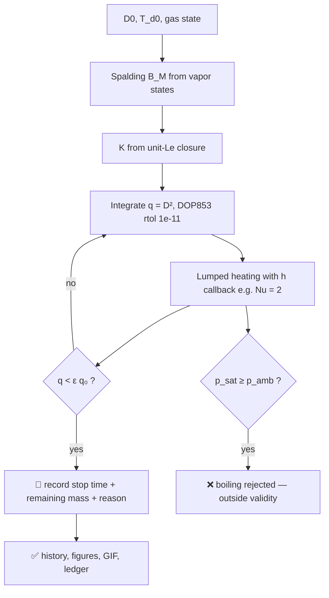

<div align="center">


# 💧 Droplet Journey

### Evaporation, heating & drag — an event-correct 0-D single-droplet model

**The frozen constant-K benchmark reaches the floating-point error floor; the coupled
model is checked against a tight-tolerance Radau reference, and every stopping rule is
stated — never silent.**

[](https://github.com/khalil-work/droplet-journey/actions/workflows/ci.yml)
[](LICENSE)
[](requirements.txt)
[](tests)
[](docs/verification.md)
[](https://github.com/khalil-work/droplet-journey/stargazers)
[](https://github.com/khalil-work/droplet-journey/commits)

[Quick start](#-quick-start) · [Model](#-model-method-and-stopping) · [Animations](#%EF%B8%8F-results-gallery-animations) · [Verification](#%EF%B8%8F-verification) · [References](#-references)

</div>

---

## 🎯 Purpose and scope

A transparent, event-correct 0-D droplet evaporation/heating model: **every equation,
closure, and stopping rule is stated**, and every recorded number is a model prediction
under documented constant conditions.

> **Scope:** single spherical droplet, quiescent constant gas, lumped temperature,
> Le = 1 mass closure, no boiling (rejected, not clamped). Not a spray, atomization,
> or validated-lifetime tool.

| | |
| --- | --- |
| 🔬 **Physics** | d²-law evaporation, Spalding mass transfer, Clapeyron surface, lumped heating |
| 🌬️ **Drag** | Schiller-Naumann C_d and free-fall terminal velocity by convergent fixed-point |
| 🧮 **Numerics** | q = D² formulation (no 1/D arithmetic), DOP853 rtol 1e-11, dense sampling |
| 🛑 **Events** | documented positive threshold stop with remaining mass and reason recorded |
| 📊 **Evidence** | 30 tests, population atlas with mass ledger, Radau cross-reference |

## 🧮 Model, method, and stopping

| Layer | Relation |
| --- | --- |
| Mass | dD/dt = −K/(2D), K = 8 k_g ln(1+B_M)/(ρ_l c_pg); exact D(t) = √(D0²−Kt) |
| Surface | Clapeyron-fit saturation; p_sat reaching ambient **raises** (boiling outside validity) |
| Thermal | lumped m_l c_pl dT_d/dt = h·πD²·(T_g−T_d) − Q_evap, sphere area πD² (a wrong πD area is a 1/D error caught by test) |
| Drag | C_d = 24/Re (1+0.15 Re^0.687) (Schiller-Naumann); terminal v from weight−buoyancy = drag |
| Integrator | state q = D², dq/dt = −K(T_d); solver failures raise, never masquerade as survival |
| Stopping | q_stop = ε q₀ (ε = 10⁻³): stop time, remaining mass ε^1.5, reason recorded |

### Life of a computed droplet



Full derivation: [docs/model.md](docs/model.md) · API: [docs/api.md](docs/api.md)

## ⚡ Quick start

```bash
python -m pip install -r requirements-dev.txt
python -m pytest tests -q                       # 30 tests: droplet + population + drag
python examples/run_verification.py             # figures + GIF + raw data
python examples/khalil_population_atlas.py      # population comparison + 61-frame GIF
```

<details>
<summary><b>📦 Verified environments</b></summary>

Python 3.13.5, NumPy 2.1.3, SciPy 1.15.3, Windows 11; CI runs the suite on Ubuntu.
The independent isolated-environment run passed in 16.43 s on Windows; runtime varies
by machine.

</details>

<details>
<summary><b>🧱 Repository layout & API example</b></summary>

```
droplet_journey/
├── model.py          # Spalding, d2 law, Clapeyron, lumped heating,
│                     # q-formulation integrator with threshold stopping
├── population.py     # analytic weighted populations, D32 and mass ledger
└── drag.py           # Schiller-Naumann drag, terminal velocity fixed-point
tests/                # 30 verification tests incl. independent references
examples/  run_verification.py  khalil_population_atlas.py
docs/      model.md  api.md  verification.md  population_atlas.md  results/
```

```python
from droplet_journey import d2_law_constant, d2_law_diameter, spalding_mass_number
from droplet_journey.drag import drag_coefficient, terminal_velocity

B_M = spalding_mass_number(0.2, 0.0)
K = d2_law_constant(rho_l=997.0, k_g=0.026, cp_g=1010.0, B_M=B_M)
D = d2_law_diameter(t=0.05, D0=80e-6, K=K)

cd = drag_coefficient(re=100.0)          # Schiller-Naumann
vt = terminal_velocity(diameter=80e-6, rho_l=997.0, rho_g=1.16,
                       mu_g=1.85e-5, g=9.81)
```

</details>

## ✅ Verification

30 tests across three suites:

- **Model (10):** hand-computed d² constant, exact-law linearity and extinction,
  Clapeyron anchor + boiling rejection, physical area scaling (catches the 1/D error),
  frozen-state exactness, threshold-stop semantics, independent tight-tolerance coupled
  Radau reference, input validation, non-finite guards.
- **Population (15):** hand values, exact extinction, weighted moments, scaling,
  mass bookkeeping, invalid inputs; mass-ledger relative error 1.12e-16
  (arithmetic closure check). [Population evidence](docs/population_atlas.md).
- **Drag (5):** Stokes limit, Schiller-Naumann anchor, monotone C_d, terminal-velocity
  force balance to 1e-9, input validation.

Evidence and limits: [docs/verification.md](docs/verification.md).

## ⚠️ Limitations

- 0-D lumped model; no internal gradients, convection, radiation, or multicomponent
  physics; constant properties.
- Le = 1 mass closure; constant latent heat; no gas-film blowing corrections.
- Boiling regimes rejected, not modeled; threshold stop is a property of the closure's
  singular endgame. Drag valid for a smooth sphere, Re ≲ 1000, no deformation.
- No experimental validation is claimed anywhere.

---

## 🎞️ Results gallery & animations

<div align="center">

**💠 Khalil Population Atlas — 16 size groups and a liquid/vapor mass ledger**

[](https://github.com/khalil-work/droplet-journey/raw/refs/heads/main/docs/results/population_atlas/khalil_population_atlas.gif)

<sub>A bespoke analytic population experiment created for this project: 16 weighted
droplet-size groups vs a monodisperse population at matched initial mass and D32.
Every animated state comes from the saved constant-K calculation.
[Equations, API and reproduction](docs/population_atlas.md).</sub>

**▶ Watch the computed droplet evolve:**


<sub>41 frames sampled uniformly from the DENSE solver solution of the coupled case
(80 µm water droplet in dry 330 K air, Nu = 2 closure, Clapeyron surface) by
<code>examples/run_verification.py</code>. The run stops at the documented positive
threshold q = 10⁻³ q₀ — recorded with its remaining mass and reason, never presented
as complete evaporation.</sub>

</div>

### 📈 Verified metrics

| Case | Metric | Value |
| --- | --- | --- |
| Frozen-surface validation (constant B_M, no heating) | max relative diameter error vs exact d² law | **1.7e-16** |
| Coupled case vs independent Radau (rtol 1e-13) reference | relative agreement on shared interval | < 1e-7 |
| Coupled case (80 µm, dry 330 K air, Nu = 2 closure) | threshold stop (ε=10⁻³) | t = 1.937 s, 3.16e-5 mass remaining, T_d = 294.2 K |
| Sphere-area scaling check | rate(D)/rate(2D) | exactly 2 at fixed h |
| Population ledger | relative error | 1.12e-16 |

### 🖼️ Static figures & raw data

- [validation_d2.png](docs/results/validation_d2.png) — frozen-surface d²-law validation
- [coupled_case.png](docs/results/coupled_case.png) — coupled heating + evaporation history
- Raw CSVs: `validation_d2.csv`, `coupled_history.csv`, `run_summary.json` in
  [docs/results/](docs/results)

## 📚 References

- G. M. Faeth, "Current status of droplet and liquid combustion" (d² law context).
- W. E. Ranz and W. R. Marshall, "Evaporation from drops" (Nu = 2 conduction limit).
- L. Schiller and A. Naumann, "A drag coefficient correlation" (Z. Ver. Dtsch. Ing., 1935).
- S. P. Lin, *Breakup of Liquid Sheets and Jets* (spray context — outside scope).

Dependencies: NumPy (BSD-3), SciPy (BSD), Matplotlib (PSF-based), Pillow (HPND),
pytest (MIT). This repository's own code is original and MIT-licensed; see
[LICENSE](LICENSE).

---

Calendar metadata: [reconstructed date records](docs/CALENDAR_HISTORY.md) were
generated on 18 October 2026. Their historical author dates are synthetic; they do
not date the software development. Original source commits and actual committer
dates are preserved.
