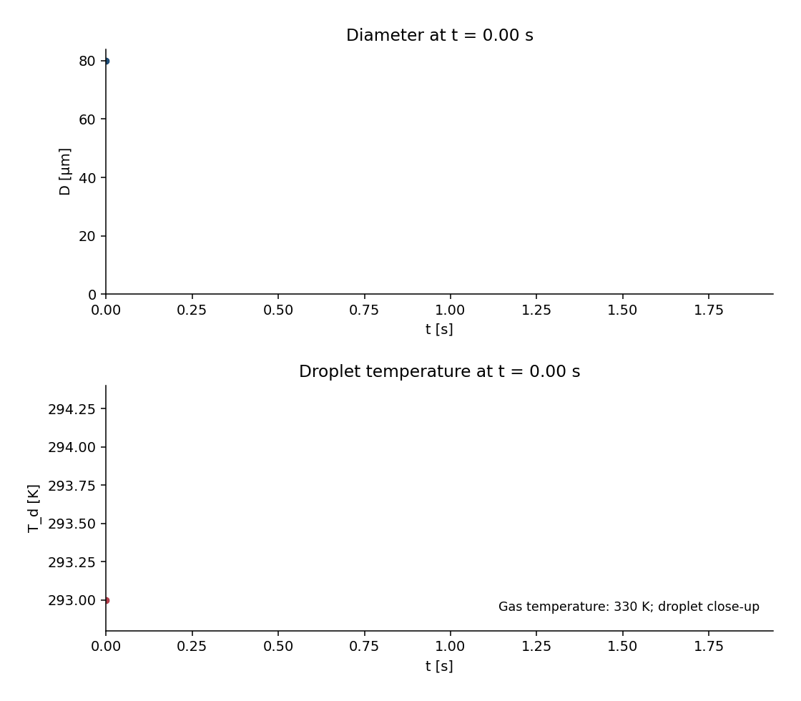

# 💧 Droplet Journey

**An original 0-D single-droplet model for evaporation, heating and explicit stopping rules. The frozen constant-K benchmark reaches the floating-point error floor; the coupled model is checked separately against a tight-tolerance Radau reference on a shared valid interval.**

[](https://github.com/khalil-official/droplet-journey/actions/workflows/ci.yml)
[](LICENSE)
[](requirements.txt)

<div align="center">

**▶ Watch the computed droplet evolve:**



<sub>41 frames sampled uniformly from the DENSE solver solution of the
coupled case (80 µm water droplet in dry 330 K air, Nu = 2 closure,
Clapeyron surface) by <code>examples/run_verification.py</code>. The run
stops at the documented positive threshold q = 10⁻³ q₀ — recorded with its
remaining mass and reason, never presented as complete evaporation.</sub>

</div>

## 🎯 Purpose and scope

A transparent, event-correct 0-D droplet evaporation/heating model: every
equation, closure, and stopping rule is stated, and every recorded number
is a model prediction under documented constant conditions. Scope: single
spherical droplet, quiescent constant gas, lumped temperature, Le = 1 mass
closure, no boiling (rejected, not clamped). Not a spray, atomization, or
validated-lifetime tool.

## 🧮 Model, method, and stopping

- Mass: dD/dt = −K/(2D), K = 8 k_g ln(1+B_M)/(ρ_l c_pg) — unit-Lewis-number
  closure stated explicitly; exact solution D(t) = √(D0²−Kt), analytical
  model extinction t_e = D0²/K.
- Surface: Clapeyron-fit saturation; p_sat reaching ambient RAISES
  (boiling outside validity).
- Thermal: lumped m_l c_pl dT_d/dt = h·πD²·(T_g−T_d) − Q_evap — **sphere
  area πD²** (a wrong πD area is a 1/D error caught by the area-scaling
  test); h supplied as a callback (demo: Nu = 2, h(D) = 2k_g/D); latent
  sink ṁ·h_fg consistent with the d² law.
- Numerics: state q = D², dq/dt = −K(T_d) directly (no 1/D arithmetic),
  DOP853 rtol 1e-11, dense solution for uniform sampling; solver failures
  raise, never masquerade as survival.
- Stopping: documented positive threshold q_stop = ε q₀ (ε = 10⁻³ default)
  with stop time, remaining mass ε^1.5, and reason recorded — the
  threshold stopping time is distinct from the analytical model extinction
  time and neither is a validated lifetime.

Full derivation: [docs/model.md](docs/model.md); API:
[docs/api.md](docs/api.md).

## ⚡ Quick start

```bash
python -m pip install -r requirements-dev.txt
python -m pytest tests -q                       # 10 verification tests
python examples/run_verification.py             # figures + GIF + raw data
```

Verified runtimes: Python 3.13.5, NumPy 2.1.3, SciPy 1.15.3, Windows 11;
CI runs the suite on Ubuntu. The independent isolated-environment run passed
10 tests in 16.43 s on Windows; runtime varies by machine. Generate the figures
and GIF with the results script above.

## 🧱 Architecture and API

```
droplet_journey/
└── model.py          # Spalding, d2 law, Clapeyron, lumped heating,
                      # q-formulation integrator with threshold stopping
tests/test_model.py   # 10 verification tests incl. independent reference
examples/run_verification.py
docs/ model.md  api.md  verification.md  results/
```

```python
from droplet_journey import d2_law_constant, d2_law_diameter, spalding_mass_number

B_M = spalding_mass_number(0.2, 0.0)
K = d2_law_constant(rho_l=997.0, k_g=0.026, cp_g=1010.0, B_M=B_M)
D = d2_law_diameter(t=0.05, D0=80e-6, K=K)
```

## 📊 Results and metrics

| Case | Metric | Value |
| --- | --- | --- |
| Frozen-surface validation (constant B_M, no heating) | max relative diameter error vs exact d² law | **1.7e-16** |
| Coupled case vs independent Radau (rtol 1e-13) reference | relative agreement on shared interval | < 1e-7 |
| Coupled case (80 µm, dry 330 K air, Nu = 2 closure) | threshold stop (ε=10⁻³) | t = 1.937 s, 3.16e-5 mass remaining, T_d = 294.2 K |
| Sphere-area scaling check | rate(D)/rate(2D) | exactly 2 at fixed h |

Raw data: [docs/results/](docs/results) — `validation_d2.csv`,
`coupled_history.csv`, `run_summary.json`; cover figure
[validation_d2.png](docs/results/validation_d2.png), coupled figure
[coupled_case.png](docs/results/coupled_case.png), animation
`droplet_journey.gif`.

## ✅ Verification

Ten tests: hand-computed d² constant, exact-law linearity and extinction,
Clapeyron anchor + boiling rejection, **physical area scaling** (catches
the 1/D area error), frozen-state exactness, threshold-stop semantics,
independent tight-tolerance coupled reference, input validation, and
non-finite guards. Evidence and limits: [docs/verification.md](docs/verification.md).

## ⚠️ Limitations

- 0-D lumped model; no internal gradients, convection, radiation, or
  multicomponent physics; constant properties.
- Le = 1 mass closure; constant latent heat and no gas-film blowing corrections.
- Boiling regimes rejected, not modeled; threshold stop is a property of
  the closure's singular endgame.
- No experimental validation is claimed anywhere.

## 📚 References

- G. M. Faeth, "Current status of droplet and liquid combustion" (d² law
  context, by title).
- W. E. Ranz and W. R. Marshall, "Evaporation from drops" (Nu = 2
  conduction limit).
- S. P. Lin, *Breakup of Liquid Sheets and Jets* (spray context — outside
  this model's scope).

Dependencies: NumPy (BSD-3), SciPy (BSD), Matplotlib (PSF-based), Pillow
(HPND), pytest (MIT). This repository's own code is original and
MIT-licensed; see [LICENSE](LICENSE).
